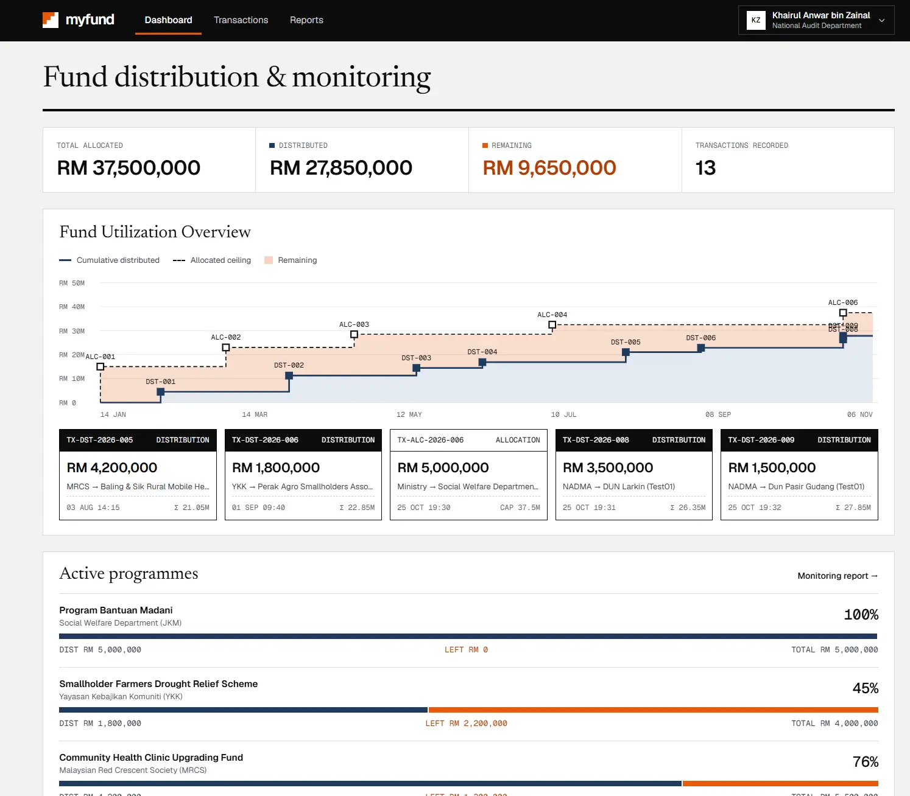

<div align="center">


<h2> MyFund - Government Fund Management System </h2>


</div>



## 1. Project Introduction

**MyFund** is a Government Fund Distribution & Monitoring System. A ministry allocates funds to agencies, agencies and NGOs record how they distribute those funds, and auditors monitor the whole flow. Every allocation and distribution is written as a transaction with a blockchain record, so the money trail is transparent and tamper-evident.

## 2. Project Overview and Features

### Architecture


| Folder            | Layer                        | Status                  |
|-------------------|------------------------------|-------------------------|
| `frontend/`       | React + Vite UI              | Ready                   |
| `backend/`        | Spring Boot REST API         | Ready                   |
| `smart-contract/` | Hyperledger Fabric chaincode | Planned                 |

### Features

- **Login & registration**: role-based sign-in for Ministry, Agency/NGO and Auditor users.
- **Dashboard**: role-aware summary of allocations and recent transactions.
- **Fund Allocation** (Ministry): create allocations to agencies.
- **Fund Distribution** (Agency/NGO): record distributions against an allocation. A distribution cannot exceed the allocation's remaining amount.
- **Transaction History** (all roles): every allocation and distribution, newest first, with a detail view showing its blockchain record.
- **Monitoring Report** (Auditor): overview of allocations, distributions and transactions for oversight.
- **Demo role switcher**: in mock mode, switch between roles without logging out.

## 3. Tech Stack


| Layer          | Technology                                                   |
|----------------|--------------------------------------------------------------|
| Frontend       | React 19, TypeScript, Vite 8, Tailwind CSS 4, Motion         |
| Backend        | Spring Boot REST API                                         |
| Blockchain     | Hyperledger Fabric chaincode `fund_cc` on `myfund-channel` (planned) |


## 4. Getting Started: Setup and Running Instructions

### Prerequisites

- [Java 25](https://adoptium.net/) (the Maven wrapper downloads Maven itself)
- [Node.js](https://nodejs.org/) 20.19+ or 22.12+ (required by Vite 8)
- [PostgreSQL](https://www.postgresql.org/download/) running on `localhost:5432`
- Windows, to use `start-dev.bat` (on macOS/Linux, run the two commands from the script by hand)

### 1. Create the database

Create an empty database named `myfund`, using pgAdmin or:

```bash
createdb -U postgres myfund
```

You don't need to create tables. Flyway creates the schema and the demo data the first time the backend starts.

### 2. Configure the backend

Create `backend/src/main/resources/application-local.properties`. This file is git-ignored and loaded automatically:

```properties
spring.datasource.password=<your postgres password>
app.jwt.secret=<base64 key, at least 32 bytes>
```

To generate a JWT secret, run `openssl rand -base64 32` (Git Bash includes `openssl`). The backend won't start without it.

The database URL and username default to `jdbc:postgresql://localhost:5432/myfund` and `postgres`. To change them, set `DB_URL` / `DB_USERNAME`, or add `spring.datasource.url` / `spring.datasource.username` to the same file.

### 3. Install frontend dependencies

```bash
cd frontend
npm install
```

### 4. Start the system

From the project root, double-click `start-dev.bat` or run:

```bat
start-dev.bat
```

It opens two windows:

| Window          | What runs                         | URL                     |
|-----------------|-----------------------------------|-------------------------|
| MyFund Backend  | Spring Boot API                   | http://localhost:8080   |
| MyFund Frontend | Vite dev server, using the real API | http://localhost:3000 |

Open **http://localhost:3000** once the backend window shows `Started MyfundApplication`. The first start takes longer because Maven downloads its dependencies. To stop the system, close both windows.

### 5. Demo accounts

All demo accounts use the password `1234`:

| Role     | Email                          |
|----------|--------------------------------|
| Ministry | `officer.mof@mof.gov.my`       |
| Agency   | `director.nadma@nadma.gov.my`  |
| Auditor  | `auditor.federal@audit.gov.my` |

### Frontend only (no backend or database)

```bash
cd frontend
npm run dev
```

Without `VITE_USE_MOCK=false`, the frontend uses an in-memory mock API and shows a demo role switcher in the header. See `frontend/.env.example`.

### Tests

```bash
cd backend && ./mvnw test     # API tests against the local myfund database (rolled back)
cd frontend && npm test      # mock API and ledger rules
cd frontend && npm run lint  # type check
```


## 5. License

Distributed under the MIT License.
