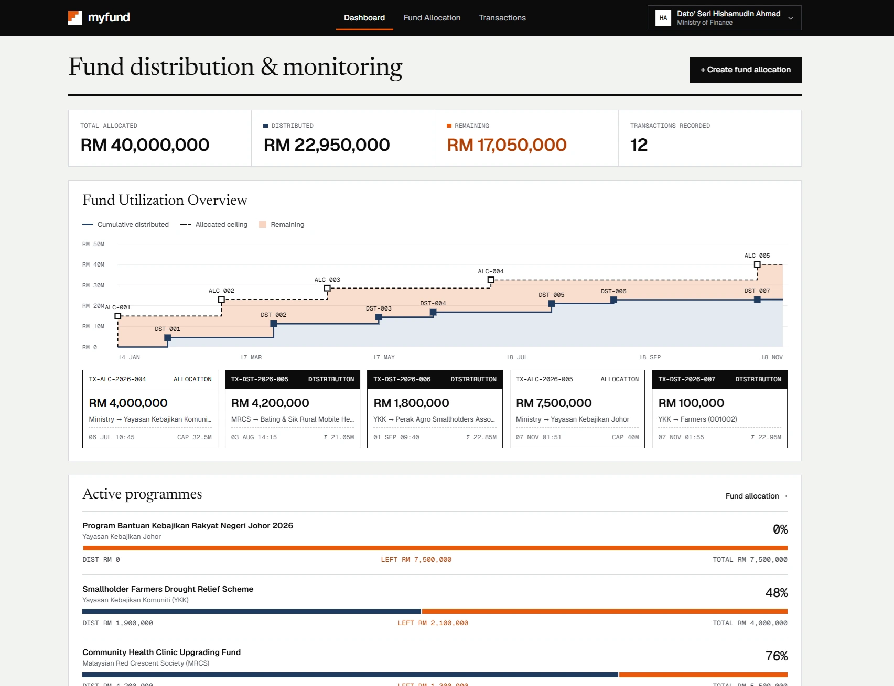

<div align="center">


<h2> MyFund - Government Fund Management System </h2>


</div>



## 1. Project Introduction

**MyFund** is a Government Fund Distribution & Monitoring System. A ministry allocates funds to agencies, agencies and NGOs record how they distribute those funds, and auditors monitor the whole flow. Every allocation and distribution is a real transaction on a Hyperledger Fabric network, so the money trail is transparent and tamper-evident.

The Fabric ledger is the source of truth. A smart contract enforces the fund rules (no overspending, an agency can only spend its own allocations, only the Ministry allocates), so not even the backend can bypass them. The backend keeps a copy in PostgreSQL, and the Auditor can check that copy against the ledger at any time.

## 2. Project Overview and Features

### Architecture


| Folder            | Layer                        | Status                  |
|-------------------|------------------------------|-------------------------|
| `frontend/`       | React + Vite UI              | Ready                   |
| `backend/`        | Spring Boot REST API         | Ready                   |
| `smart-contract/` | Hyperledger Fabric network and `fund_cc` contract | Ready |

```
        Orderers: orderer1, orderer2, orderer3 (Raft)
                          |
                 channel: myfund-channel
        /                 |                \
  MinistryMSP         AgencyMSP          AuditorMSP
  peer0 + fund_cc     peer0 + fund_cc    peer0 + fund_cc
        \                 |                /
             Spring Boot backend (Fabric Gateway)
                          |
              PostgreSQL copy + React frontend
```

Allocations need the Ministry and Auditor peers to endorse them; distributions need the Agency and Auditor peers.

### Features

- **Login & registration**: role-based sign-in for Ministry, Agency/NGO and Auditor users.
- **Dashboard**: role-aware summary of allocations and recent transactions.
- **Fund Allocation** (Ministry): create allocations to agencies.
- **Fund Distribution** (Agency/NGO): record distributions against the agency's own allocations. The contract refuses any distribution above the remaining balance, or from another agency's allocation.
- **Transaction History** (all roles): every allocation and distribution, newest first, with a detail view showing its blockchain record.
- **Monitoring Report** (Auditor): overview of allocations, distributions and transactions, plus a **ledger vs database verification** that compares every record on the chain with the PostgreSQL copy and lists any difference.

## 3. Tech Stack


| Layer          | Technology                                                   |
|----------------|--------------------------------------------------------------|
| Frontend       | React 19, TypeScript, Vite 8, Tailwind CSS 4, Motion         |
| Backend        | Java 25, Spring Boot 4, PostgreSQL, Fabric Gateway SDK       |
| Blockchain     | Hyperledger Fabric 2.5 LTS, run in Docker                    |


## 4. Getting Started: Setup and Running Instructions

### Prerequisites

- Java 25 with maven
- Node.js version 20.19+ or 22.12+ (required by Vite 8)
- PostgreSQL 
- WSL 2 with **Ubuntu** distribution 
- Docker Desktop with the WSL 2 backend and *WSL integration* turned on for Ubuntu. 

Nothing Fabric-related is installed on your machine: the network, the contract and its build all run in containers. Plan for about 1.5 GB of free memory for them.

### 1. Create the database

Create an empty database named `myfund`, using pgAdmin or:

```bash
createdb -U postgres myfund
```

You don't need to create tables. Flyway creates the schema the first time the backend starts.

### 2. Configure the backend

Create `backend/src/main/resources/application-local.properties`. This file is git-ignored and loaded automatically:

```properties
spring.datasource.password=<your postgres password>
app.jwt.secret=<base64 key, at least 32 bytes>
```

To generate a JWT secret, run `openssl rand -base64 32` (Git Bash includes `openssl`). The backend won't start without it.

The database URL and username default to `jdbc:postgresql://localhost:5432/myfund` and `postgres`. To change them, set `DB_URL` / `DB_USERNAME`, or add `spring.datasource.url` / `spring.datasource.username` to the same file.

### 3. Install frontend dependencies

```bash
cd frontend
npm install
```

### 4. Start the system

From the project root, double-click `start-dev.bat` or run:

```bat
start-dev.bat
```

It first starts the Fabric network in WSL (`smart-contract/network.sh up`), then opens two windows:

| Window          | What runs                         | URL                     |
|-----------------|-----------------------------------|-------------------------|
| MyFund Backend  | Spring Boot API                   | http://localhost:8080   |
| MyFund Frontend | Vite dev server                   | http://localhost:3000   |

The first run takes several minutes: Docker downloads the Fabric images and builds the contract, and Maven downloads its dependencies.

When the backend first meets an empty ledger, it submits the 10 sample records (4 allocations, 6 distributions) as real transactions, which takes about 20 seconds. Open **http://localhost:3000** once the backend window shows `Seeded 10 records on the ledger` (or, on later starts, `not seeding`). If that first start is interrupted, the next start submits whichever sample records are missing.

To stop the system, close both windows, then stop the network with `wsl -d Ubuntu --cd smart-contract ./network.sh down`. The ledger data is kept and survives a restart of the PC.

The sample records are illustrative figures, not real government data. The app says so in its footer.

### 5. Demo accounts

All demo accounts use the password `1234`:

| Role     | Email                          |
|----------|--------------------------------|
| Ministry | `officer.mof@mof.gov.my`       |
| Agency   | `director.nadma@nadma.gov.my`  |
| Auditor  | `auditor.federal@audit.gov.my` |

### The blockchain network

Run these in Ubuntu (WSL), from `smart-contract/`:

| Command               | What it does |
|-----------------------|--------------|
| `./network.sh up`     | Creates keys and the channel if missing, starts 3 orderers, 3 peers and 3 contract containers, and deploys `fund_cc`. Safe to re-run. |
| `./network.sh down`   | Stops everything and keeps the ledger. |
| `./network.sh reset`  | Stops everything and wipes the ledger, keys and channel. The next backend start reseeds the sample records. |
| `./network.sh status` | Shows each node's channel height and the deployed contract. |
| `./verify.sh`         | Live end-to-end check (see Tests). Stop the backend first. |

Keys and certificates are generated into `smart-contract/network/organizations/`, which is git-ignored and must never be committed.

### Tests

```bash
cd backend && ./mvnw test     # API tests with an in-memory ledger; Postgres writes roll back
cd frontend && npm test      # formatter and chart-total checks
cd frontend && npm run lint  # type check
```

The contract's own unit tests run inside Docker whenever its image is built, which `network.sh up` does. To run them on their own: `docker build --target build smart-contract/chaincode`.

`smart-contract/verify.sh` checks the real system end to end. It rebuilds the chain from nothing, starts the backend in a new window, and then checks:
- seeding;
- writes;
- the contract's refusals, both through the API and directly on the peers;
- tampering with PostgreSQL;
- a stopped orderer and a stopped Auditor peer;
- a network restart.

It prints PASS or FAIL for each check. It leaves a few clearly named check records on the chain; run `./network.sh reset` and restart the backend for a clean demo.

## 5. License

Distributed under the MIT License.
